# AEDPC: Reconstructing density-peak clusters with adaptive local ellipsoids

<p align="center">
  
</p>

The full mechanism walkthrough (1080p, 75 s; [download MP4](assets/AEDPC_mechanism.mp4)):

https://github.com/user-attachments/assets/212c9ebc-cd68-4b4c-8ba0-4f6586fdc5e9


A cluster that bends, widens or splits into several dense regions cannot be described by one centre or one global shape. Density peaks find the dense regions, but someone still has to decide **which regions belong together**.

AEDPC (Adaptive Ellipsoidal Density-Peak Clustering) makes that decision with local shape. Density ascent splits the data into small components, each component gets its own regularized ellipsoid, and two components are joined only where their **observed contact fits both ellipsoids**. The ellipsoids are kept to the end, so one cluster can hold several peaks, orientations and widths. The number of clusters is inferred from the data.

**Results reported in the paper** (twelve compared methods):

- recovers all eight artificial reference partitions exactly;
- highest adjusted Rand index (ARI) on all ten real-world and visual datasets, and 68 of 80 task–metric first places;
- matched controls credit the local geometry with a mean ARI gain of 0.1439; on strongly bent Pendigits the full method keeps ARI 0.7820 while the variant without ellipsoids falls to near zero;
- on STL10 (CLIP ViT-B/32 features), ARI rises from 0.3538 to 0.5514 with 66.00% less clustering time than the strongest comparator.

> The paper is currently under review at *Pattern Recognition*. Citation details will be added here after publication.

## Repository contents

| Path | Contents |
|---|---|
| [`AEDPC.py`](AEDPC.py) | Single-file implementation of AEDPC (density estimation, density ascent, local ellipsoids, contact graph and reconstruction) |
| [`AEDPC_sensitivity.py`](AEDPC_sensitivity.py) | Same implementation with a wider admissible range for `oas_shrinkage_multiplier`; used only for the regularization scan |
| [`requirements.txt`](requirements.txt) | Library versions used for the reported runs |
| [`results/`](results/) | Experiment results: one workbook per dataset, paired tests, artificial benchmarks and all ablation data ([guide](results/README.md)) |
| [`assets/`](assets/) | Mechanism animation (MP4), GIFs and figures used in this README |

## Installation

Python 3.12 is recommended.

```bash
pip install -r requirements.txt
```

The dependencies are `numpy`, `scipy`, `scikit-learn`, `networkx`, `diptest`, `dadapy` (0.3.4) and `hnswlib`. `hnswlib` is needed only when the HNSW neighbour backend is requested.

## Usage

AEDPC follows the scikit-learn clustering interface. Put `AEDPC.py` on your path and call `fit_predict`:

```python
import numpy as np
import AEDPC as aedpc

X = np.load("features.npy")                      # (n_samples, n_features)

config = aedpc.AEDPCConfig(alpha_n=0.000225, alpha_m=0.1)
model = aedpc.AEDPC(alpha_n=config.alpha_n, alpha_m=config.alpha_m, config=config)
labels = model.fit_predict(X)                    # the number of clusters is inferred
```

- `AEDPC` selects the reconstruction view automatically; `AEDPCCore` is the configurable core estimator (used for the visual experiment).
- `alpha_n` controls neighbourhood and density decisions; `alpha_m` controls graph and shape decisions.
- Reference labels are never used during fitting.

Controls adopted in the paper:

| Dataset | `alpha_n` | `alpha_m` |
|---|---|---|
| Ecoli | 0.000225 | 0.1 |
| Banknote | 0.001 | 0.05 |
| HTRU2 | 0.006 | 0.05 |
| Rice | 0.002 | 0.05 |
| Ionosphere | 0.006 | 0.05 |
| Libras Movement | 0.0005 | 0.1 |
| Pendigits | 0.0005 | 0.1 |
| WDBC | 0.0005 | 0.1 |
| Wine | 0.01 | 0.05 |
| STL10 | 5.3e-06 | 0.002 |

Neighbour search is exact up to 3,000 observations. HTRU2 and Rice use HNSW with `M=16`, `efConstruction=200`, `efSearch=400` and deterministic insertion; WDBC, Libras Movement and Pendigits use exact search throughout, and STL10 uses exact search with 15 neighbours. Runs are single-threaded and take the seed from the configuration.

The datasets are public (UCI Machine Learning Repository, the Clustering benchmarks collection and STL10). The preprocessed feature matrices used in the paper are available from the authors on request.

## Experiment results

[`results/`](results/) contains every number reported in the paper: per-dataset results of AEDPC and all twelve comparators on eight external indices with clustering time, the paired Wilcoxon comparisons, the artificial benchmarks, and the data behind every ablation and sensitivity analysis. See [`results/README.md`](results/README.md) for the column guide.

## How AEDPC works

The walkthrough below follows the [mechanism video](assets/AEDPC_mechanism.mp4) on a two-dimensional example. It is illustrative and computed with a compact re-implementation of each module; all reported results use `AEDPC.py`.

The animation runs AEDPC step by step on 434 points that form two interleaved crescents.

| Stage | Modules |
|---|---|
| **Preparation** | [1. Raw points](#1-raw-points) → [2. Adaptive density](#2-adaptive-density) → [3. Density ascent](#3-density-ascent) → [4. Observed contacts](#4-observed-contacts) |
| **Local shape** | [5. Local ellipses](#5-local-ellipses) |
| **Contact check** | [6. Boundary support B](#6-boundary-support-b) → [7. Cross-envelope check G](#7-cross-envelope-check-g) → [8. Component graph W](#8-component-graph-w) |
| **Rebuild** | [9. Candidate groups](#9-candidate-groups) → [10. Recurrent cores](#10-recurrent-cores) → [11. Ellipse absorption](#11-ellipse-absorption) |
| **Output** | [12. Final clusters](#12-final-clusters) |

### Preparation

#### 1. Raw points


- **How it works:** 434 unlabeled points. They form two crescents that bend, change width and come close to each other in two places.
- **Why it matters:** One centre or one global shape cannot describe a bent cluster. This is the case AEDPC is built for.
- **Result in this run:** 434 points; Number of clusters: unknown to the algorithm

#### 2. Adaptive density

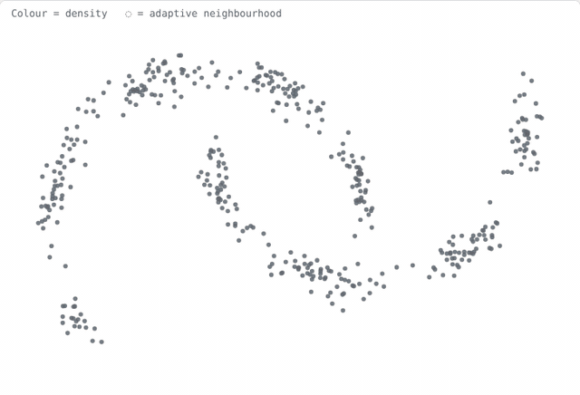

`P = log-density − z · uncertainty`

- **How it works:** Every point gets a density score. Each neighbourhood adapts to the data: large circles where points are sparse, small where they are dense.
- **Why it matters:** Density decides which way every point will “flow” next. Reliable density gives reliable components for the geometry to work on; in the paper, a fixed-size neighbourhood instead lowers mean ARI by 0.44.
- **Result in this run:** Neighbourhood radius; 0.046 (dense) to 0.318 (sparse)

#### 3. Density ascent

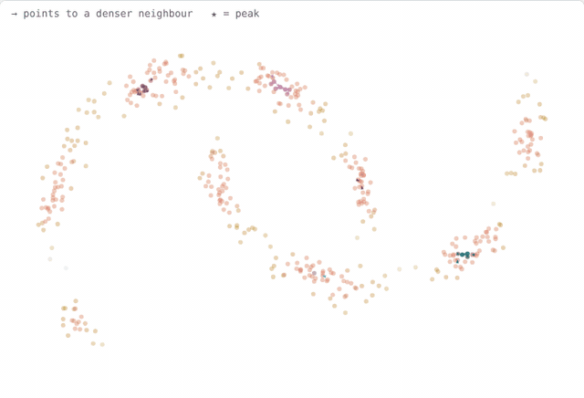

`parent(i) = a neighbour with strictly higher P`

- **How it works:** Each point points to a neighbour that is strictly denser. Points with no denser neighbour are peaks (★). Everything that flows to the same peak becomes one component.
- **Why it matters:** A bent cluster has several peaks. Instead of forcing one peak per cluster, AEDPC keeps each peak’s tree as a building block.
- **Result in this run:** 9 components; 5 on the upper crescent, 4 on the lower; More peaks than clusters

#### 4. Observed contacts

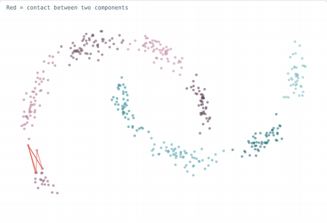

- **How it works:** Find neighbour pairs whose two points sit in different components. These red links are the places where components actually touch.
- **Why it matters:** AEDPC decides merges only where components meet, not by comparing their centres. No contact means no link.
- **Result in this run:** 86 contacts between 8 component pairs; Some cross between the two crescents

### Local shape

#### 5. Local ellipses

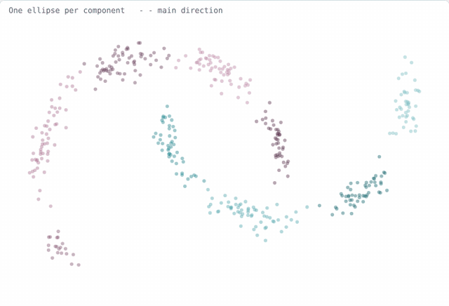

`p(x) = distance to centre ÷ envelope size (p < 1 inside)`

- **How it works:** Fit an ellipse to every component: its main direction, its width, and an envelope holding 95% of its points. Small components fall back to circles.
- **Why it matters:** A gap along the long axis is normal; the same gap across the narrow axis is a boundary. The ellipse makes that difference measurable.
- **Result in this run:** Long/short axis ratio; from 1.61 to 3.92

### Contact check

#### 6. Boundary support B

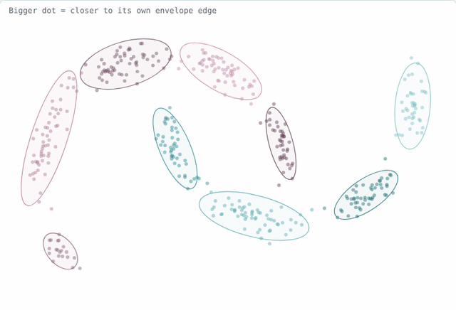

`B = weighted contact amount ÷ boundary size of both sides`

- **How it works:** Points close to their own envelope edge count the most (bigger dots). Contacts are weighted by these points and by their length, then summed for each pair.
- **Why it matters:** B answers “how much do these two pieces touch?” It is normalised, so a big component does not win just by having more points.
- **Result in this run:** Most contact: 3–4 (B 0.011); Least contact: 5–7 (B 0.001)

#### 7. Cross-envelope check G

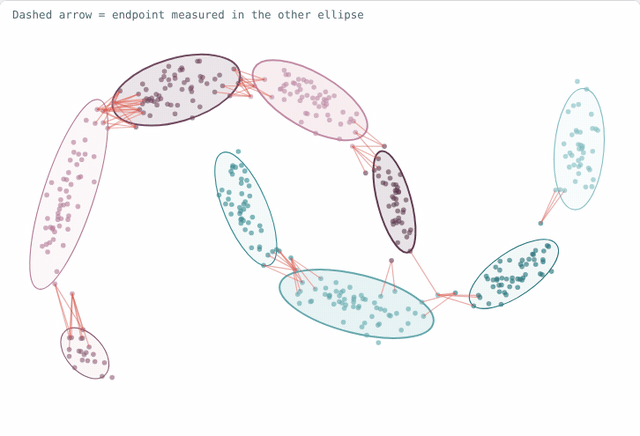

`g = exp(−½ · [overshoot of xᵢ in B’s ellipse + overshoot of xⱼ in A’s ellipse])`

- **How it works:** Take a contact. Measure its endpoint from A inside B’s ellipse, and its endpoint from B inside A’s ellipse. Only overshooting the envelope is penalised.
- **Why it matters:** A contact along the curve sits almost inside both shapes, so g stays high. An accidental contact across a narrow side overshoots, so g drops.
- **Result in this run:** Same crescent 3–4: g = 0.760; Across crescents 5–7: g = 0.386; Centre-to-centre would give 0.195 vs 0.054

#### 8. Component graph W

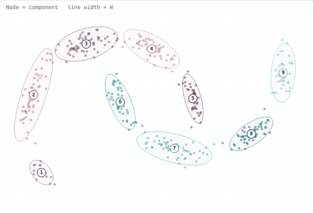

`W = √(B · G)`

- **How it works:** Combine how much the pieces touch (B) with whether the touch makes sense geometrically (G). Each component becomes a node; thicker line = stronger link.
- **Why it matters:** A strong link needs both: enough contact, and contact in a plausible place. Pieces that never touch get no link at all.
- **Result in this run:** Strongest link: 3–4 (W 0.087); Weakest link: 5–7 (W 0.022)

### Rebuild

#### 9. Candidate groups

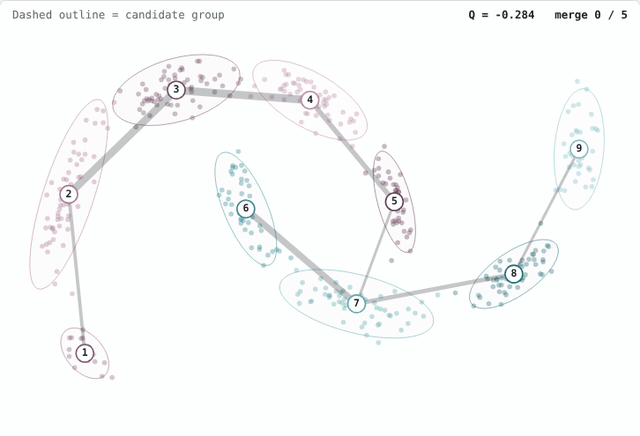

`maximise Σ (weight inside group) − γ · (group size)²`

- **How it works:** Merge nodes step by step while the groups hold clearly more link weight than chance would give (Markov stability / modularity).
- **Why it matters:** This only proposes groups. Having more groups than clusters is fine here; the next steps decide which ones are real.
- **Result in this run:** 4 candidate groups; {4,5} {8,9} {1,2,3} {6,7}

#### 10. Recurrent cores

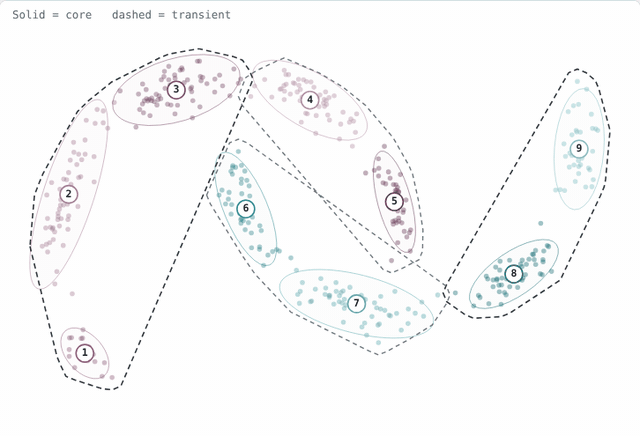

`retention = share of graph flow that stays inside the group`

- **How it works:** Imagine a random walk on the graph. Groups that keep the walk inside become cores; the others are transient. A shape test sets the minimum number of clusters (2 here).
- **Why it matters:** Cores anchor the final clusters, so a bent cluster is neither cut into pieces nor merged with its neighbour.
- **Result in this run:** Cores: {8,9} {1,2,3}; Transient: {4,5} {6,7}

#### 11. Ellipse absorption

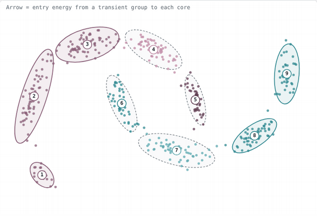

`entry energy = median over points of the distance to the nearest ellipse in the core`

- **How it works:** Each transient group joins one core as a whole. For each core, measure how well the group fits that core’s nearest ellipse. The lowest “entry energy” wins.
- **Why it matters:** It uses every small ellipse inside the core, not one big shape, so the end of a curve is caught by the segment right next to it.
- **Result in this run:** {4,5} → {1,2,3}: E 3.45 vs 9.64; {6,7} → {8,9}: E 5.64 vs 7.42

### Output

#### 12. Final clusters

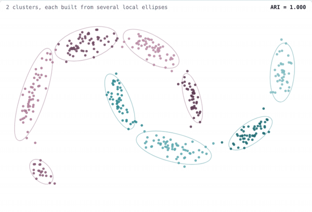

- **How it works:** Every point takes the label of its component. Each cluster keeps its own set of local ellipses, so one cluster can hold several peaks, directions and widths.
- **Why it matters:** Switch the geometric check off (G = 1) or measure centres instead of contact points: the crossing contacts start to look acceptable and the crescents get mixed.
- **Result in this run:** the full method separates the two crescents exactly. Switching the geometric check off, or measuring centres instead of contact points, mixes them.

| Full AEDPC | Without G (G = 1) | Centre check |
|:---:|:---:|:---:|
| 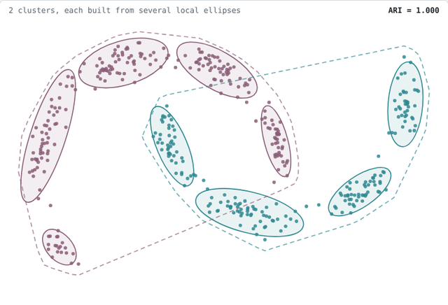 | 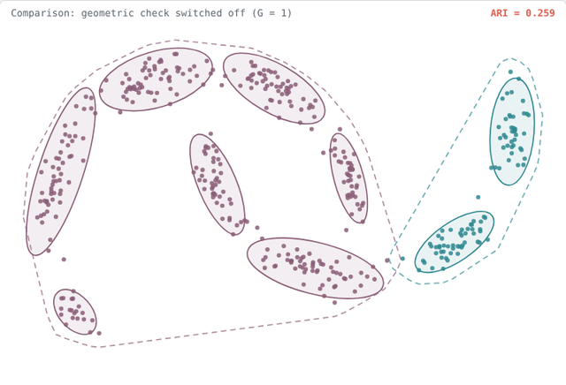 | 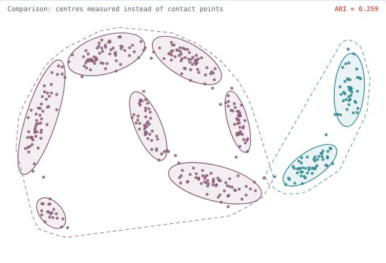 |
| ARI **1.000** | ARI 0.259 | ARI 0.259 |


## License

This project is released under the [MIT License](LICENSE).
